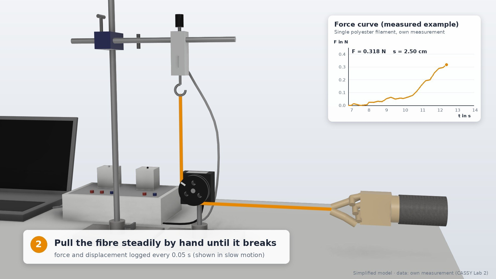
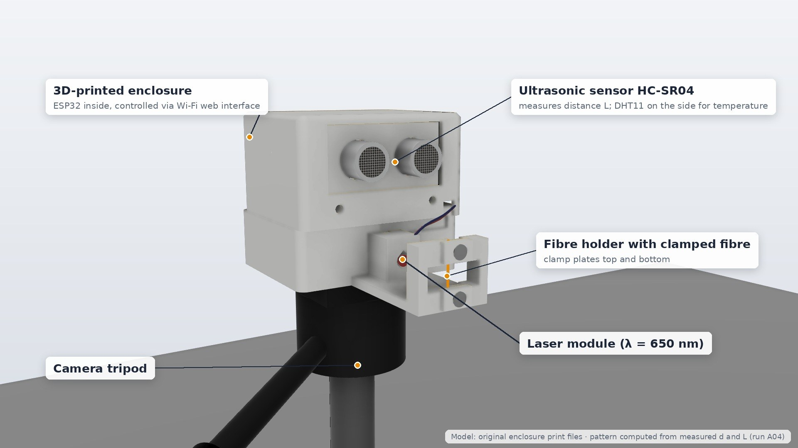
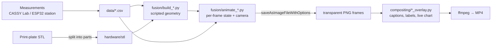

# fiberlab — from a real lab bench to a scripted 3D twin

**Two fibre-mechanics experiments, rebuilt as code.** This repository contains everything behind a small materials-science project comparing **spider silk** with polyester, ceramic fibre and human hair:

1. a **self-built ESP32 laser-diffraction station** that measures fibre diameters in the micrometre range,
2. **parametric 3D reconstructions** of both experimental setups, generated entirely through the **Autodesk Fusion Python API**,
3. a **frame-accurate animation pipeline** that drives the 3D scenes with the *real measured data*, renders each frame from Fusion, and composites captions, labels and live charts in Python.

No GUI modelling, no keyframing by hand: every body, camera move, fibre, laser beam and diffraction fringe is produced by a script.

| Tensile test | Laser diffraction |
|---|---|
|  |  |
| [▶ tensile_test.mp4](docs/media/tensile_test.mp4) (36 s) | [▶ laser_diffraction.mp4](docs/media/laser_diffraction.mp4) (35 s) |

---

## What makes it interesting

- **Data-driven animation.** The pulley in the tensile-test video turns by exactly the measured displacement (Δs = 3.09 cm → φ = −s/r), and the inset chart replays the recorded force curve of a single polyester filament up to its break at F<sub>max</sub> ≈ 0.38 N.
- **Physically computed diffraction pattern.** The fringes on the wall are not drawn — they are evaluated per strip from the far-field intensity of a thin fibre (Babinet's principle, single-slit equivalent)
  `I(x) = (sin β / β)²,  β = π·d·sin(atan(x/L)) / λ`
  using the *measured* diameter d = 7.42 µm, distance L = 39.88 cm and λ = 650 nm. The 2nd-order minima land exactly at the measured spacing a = 14.2 cm.
- **Real hardware, real files.** The station's enclosure is imported from the original 3D-print STL plate, split into parts by connected-component analysis and re-assembled in Fusion in its printed configuration.
- **Robust rendering at scale.** ~1,300 frames rendered headlessly from Fusion (`Viewport.saveAsImageFileWithOptions`, transparent background) in time-boxed batches, then composited in parallel workers that only fill in missing frames.

## Repository layout

```
firmware/laser_station/   ESP32 firmware + web UI of the diffraction station (Arduino)
fusion/                   Fusion API scripts: build the scenes, animate, render frames
compositing/              Pillow overlays: captions, callouts, live force chart, results
hardware/stl/             Enclosure parts of the station (split from the print plate)
data/                     Measurement data used by the animations (CSV, English headers)
docs/                     Method notes, physics, pipeline, media (videos + stills)
```

## Pipeline



Details: [docs/PIPELINE.md](docs/PIPELINE.md) · physics: [docs/PHYSICS.md](docs/PHYSICS.md) · station: [firmware/laser_station/README.md](firmware/laser_station/README.md)

## Quick start

**Fusion scenes** (Autodesk Fusion, *Utilities → Scripts and Add-Ins*):
1. Set `REPO = r"…"` at the top of the scripts in `fusion/` to your clone.
2. Run `build_tensile_setup.py` or `build_laser_station.py` – a new design is created and saved to the active project.
3. From a small script, call `render(range(a, b))` of `animate_tensile.py` / `animate_laser.py` (batches of ~150 frames). Frames go to `output/frames_*`.

**Compositing** (Python ≥ 3.9, Pillow, ffmpeg):
```bash
pip install pillow
python compositing/tensile_overlay.py 0 900      # or: run_missing.py tensile_overlay 900 0 2  (parallel, resumable)
ffmpeg -framerate 25 -i output/composited_tensile/o%04d.jpg -c:v libx264 -crf 18 -pix_fmt yuv420p tensile.mp4
```

**Station firmware**: see [firmware/laser_station](firmware/laser_station).

## Results (laser diffraction, run A04, 4 samples per fibre)

| Fibre | d (mean ± SD) |
|---|---|
| Spider silk (dragline) | 7.33 ± 0.21 µm |
| Ceramic fibre | 15.44 ± 0.19 µm |
| Polyester (single filament) | 17.53 ± 0.22 µm |
| Human hair | 60.40 ± 0.76 µm |

Small-angle approximation deviates by only −0.1 … −1.6 % from the exact evaluation.

## Honest limitations

- The tensile-test bench is reconstructed from photographs (simplified geometry, no CAD source).
- Appearance names in Fusion are localized; scripts contain a German→English map and fall back gracefully.
- The station's web UI and some firmware comments are in German.

## How it was built

Designed, built and measured by me; the Fusion/compositing code was developed together with an AI coding agent (Claude) that operated Fusion through its API, under my direction and review. The project is a case study in using an agent to turn messy real-world artefacts — photos, STL plates, CSV exports, firmware — into a reproducible, data-faithful 3D visualisation.

## License

MIT — see [LICENSE](LICENSE).
